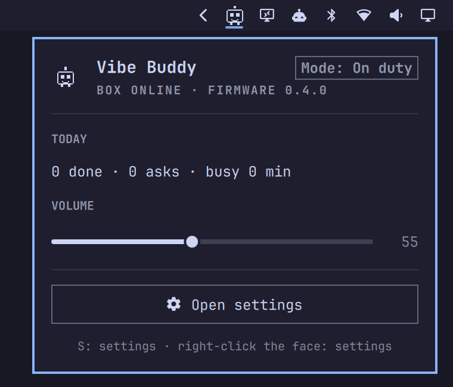

# VibeBuddy — Omarchy shell plugin



The [VibeBuddy](https://github.com/second-state/vibebuddy) box in your Omarchy bar. The
icon is the buddy's face; its eyes close and it dims when the box or the daemon is gone.
Click it for a panel with:

- whether the box is online, and its firmware;
- its mode (On duty, Pomodoro or Leisure);
- today's stats: done, asks and busy time;
- the box's volume;
- progress while a character pack is written or firmware is flashed;
- a button that opens the full settings window.

It never shows what your agents are doing: that's the box's job.

## Install

Install VibeBuddy first; this plugin is only a front end for its daemon, `vibebuddyd`.
See [Linux](https://github.com/second-state/vibebuddy#linux-experimental) in its README
(`install.sh`, or the pacman package on Arch and Omarchy). Then:

```bash
omarchy plugin add https://github.com/second-state/omarchy-vibebuddy-plugin --enable
```

While the plugin is in the bar, the VibeBuddy app (newer than 0.4.0) leaves out its own
tray icon, so the face shows once; disable the plugin and the tray icon comes back. On
Omarchy, VibeBuddy's `install.sh` adds and enables the plugin for you.

## Use

- Click the face to open the panel; right-click it to open the settings window.
- In the panel, `S` opens the settings window.
- Scripts and tests can read the plugin's state:
  `qs ipc -p "$OMARCHY_PATH/shell" call vibebuddy state`

If the daemon isn't running, the panel says so. It runs as a user service; VibeBuddy's
[Linux instructions](https://github.com/second-state/vibebuddy#linux-experimental) say how to
start it.

## Remove

```bash
omarchy plugin remove io.github.second-state.vibebuddy
```

This removes only the bar widget. VibeBuddy itself, its daemon and its hooks are untouched.

## Dependencies and privileges

- Runs unsandboxed inside the Omarchy shell, with your user's permissions, like every
  Omarchy plugin.
- Talks only to `vibebuddyd` on `127.0.0.1:7331`, with `curl`: it reads the status stream
  and, when you move the slider, sets the volume. It also starts `vibebuddy-desktop`
  when you ask for the settings window. No other network access, no files written.

## Develop

```bash
omarchy plugin validate .
```

License: GPL-3.0-or-later, like VibeBuddy.
